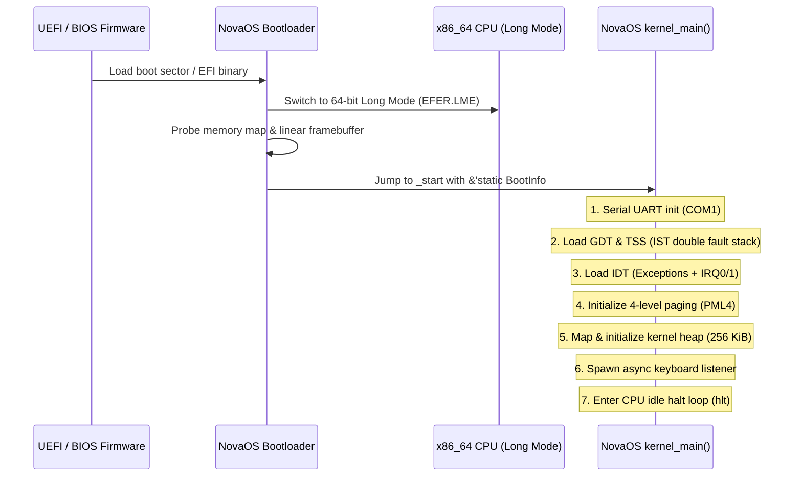

# NovaOS Kernel Architecture & Systems Manual

**Architecture:** `x86_64` (64-bit Long Mode)  
**Privilege Level:** Ring 0 (Kernel Mode)  
**Language:** Rust (`#![no_std]`, freestanding)  
**Firmware Interface:** UEFI / BIOS Handover via Typed Bootloader  
**Execution Model:** Preemptive / Cooperative Async Waker Runtime  

---

## 1. System Overview

NovaOS is a genuine bare-metal operating system kernel built from line zero in freestanding Rust. It executes directly on physical x86_64 processors or virtual machine hypervisors (QEMU, KVM, VMware, VirtualBox) without depending on an underlying host operating system, standard C library, or runtime environment.

```text
+-----------------------------------------------------------------+
|                  Userland Applications (Ring 3)                 |
+-----------------------------------------------------------------+
                               |  SYSCALL / SYSRET
+-----------------------------------------------------------------+
|                  NovaOS Microkernel Core (Ring 0)               |
|                                                                 |
|  +-----------------------+     +-----------------------------+  |
|  | Task Executor / Waker |     | Kernel Heap (Box, Vec, Str) |  |
|  +-----------------------+     +-----------------------------+  |
|              |                                |                 |
|  +-----------------------+     +-----------------------------+  |
|  | Interrupt Manager     |     | 4-Level Paging & Frame Alloc|  |
|  | (IDT, PIC, Exceptions)|     | (PML4, PDPT, PD, PT, CR3)   |  |
|  +-----------------------+     +-----------------------------+  |
|              |                                |                 |
|  +-----------------------+     +-----------------------------+  |
|  | GDT & TSS (IST Stack) |     | Hardware Drivers            |  |
|  | Emergency Recovery    |     | (UART 16550, VGA, PS/2 Key) |  |
|  +-----------------------+     +-----------------------------+  |
+-----------------------------------------------------------------+
                               |
+-----------------------------------------------------------------+
|                x86_64 Physical Hardware / QEMU CPU              |
+-----------------------------------------------------------------+
```

---

## 2. Boot Sequence & Handover Protocol



1. **Firmware Stage:** The host UEFI firmware validates system hardware, initializes basic devices, and executes the bootloader.
2. **Long Mode Transition:** The bootloader enables `PAE` (Physical Address Extension), builds preliminary 4-level page tables, sets `CR4.PAE` and `EFER.LME`, activates paging in `CR0.PG`, and performs a far jump into 64-bit long mode.
3. **BootInfo Handover:** The bootloader populates a structured memory map (`MemoryMap`) and calculates the virtual address offset where all physical memory is mapped (`physical_memory_offset`), passing a reference to `kernel_main`.

---

## 3. Memory Architecture

### 3.1 4-Level Virtual Memory Paging
Virtual addresses are 64 bits wide (with canonical sign-extension for bits 48..63). The CPU translates virtual to physical addresses through 4 page table levels:

```text
64-Bit Virtual Address Breakdown:
+-------------------+---------+---------+---------+---------+---------------+
| Sign Extension    | PML4    | PDPT    | PD      | PT      | Page Offset   |
| (Bits 48..63)     | (9 bits)| (9 bits)| (9 bits)| (9 bits)| (12 bits)     |
+-------------------+---------+---------+---------+---------+---------------+
                         |         |         |         |             |
                        CR3     Level 3   Level 2   Level 1    Physical Page
```

* **CR3 Register:** Stores the physical address of the Level 4 Page Table (PML4).
* **OffsetPageTable:** All physical memory is mapped into the higher half of virtual memory at `boot_info.physical_memory_offset`. This permits the kernel to modify any page table entry safely by applying the offset.

### 3.2 Physical Frame Allocator
`BootInfoFrameAllocator` scans the UEFI `MemoryMap` for regions marked `MemoryRegionType::Usable` and dispenses 4096-byte `PhysFrame` allocations sequentially.

### 3.3 Dynamic Kernel Heap
* **Heap Virtual Address Range:** `0x4444_4444_0000` to `0x4444_4444_0000 + 256 KiB`.
* **Allocator:** `LockedHeap` linked-list allocator providing Rust global allocation (`#[global_allocator]`).
* Enables full usage of standard heap primitives in `#![no_std]`: `Box`, `Vec`, `String`, `Arc`, `BTreeMap`.

---

## 4. Descriptor Tables & Exception Handling

### 4.1 Global Descriptor Table (GDT) & TSS
The GDT defines memory segments and privilege levels. Crucially, the GDT holds the **Task State Segment (TSS)** with an **Interrupt Stack Table (IST)**:
* `DOUBLE_FAULT_IST_INDEX = 0`: Configures a dedicated 20 KiB emergency stack for double faults.
* **Triple Fault Immunity:** If a kernel thread encounters a stack overflow, the CPU cannot push the exception frame to the current broken stack. The IST forces an immediate hardware switch to the dedicated emergency stack, preventing instant hardware reset / triple fault.

### 4.2 Interrupt Descriptor Table (IDT)
The IDT defines 256 interrupt gates handling both CPU exceptions and hardware IRQs:

| Vector | Name | Type | Action |
|---|---|---|---|
| `0x00` | Division Error | CPU Exception | Halts faulting thread, prints panic |
| `0x03` | Breakpoint | CPU Exception | Debug trap, dumps register state |
| `0x08` | Double Fault | CPU Exception (IST) | Catches stack overflows on emergency stack |
| `0x0D` | General Protection Fault | CPU Exception | Reports privilege/segmentation violation |
| `0x0E` | Page Fault | CPU Exception | Reads `CR2` register, inspects error code |
| `0x20` | PIC Timer (IRQ0) | Hardware IRQ | Increments system ticks, wakes scheduler |
| `0x21` | PS/2 Keyboard (IRQ1) | Hardware IRQ | Reads port `0x60`, enqueues scancode |

---

## 5. Hardware Drivers

### 5.1 UART 16550 Serial Port (COM1)
* **Base Port:** `0x3F8`.
* **Purpose:** High-reliability debug output streamed directly to the terminal stdout in QEMU via `-serial stdio`.
* **Macros:** `serial_print!`, `serial_println!`.

### 5.2 VGA Text Buffer
* **Physical Address:** `0xb8000`.
* **Dimensions:** 80 columns × 25 rows (16 colors).
* **Features:** Memory-mapped volatile writes, automatic row scrolling, thread-safe spinlock wrapper (`WRITER: Mutex<Writer>`).
* **Macros:** `print!`, `println!`.

### 5.3 Programmable Interrupt Controller (8259 PIC)
* Two chained 8259 PIC chips remapped from IBM PC legacy BIOS vectors (`0x08..0x0F`) to vectors `32..47` to eliminate collision with CPU internal exceptions.
* End of Interrupt (EOI) dispatched upon servicing each hardware event.

---

## 6. Preemptive & Cooperative Multitasking

NovaOS implements a hybrid waker-driven async/await execution model:
* **Tasks:** Packaged futures with assigned `TaskId` integers.
* **Wakers:** Interrupt handlers (e.g., PS/2 keyboard) push data into a lockless `ArrayQueue` and invoke `WAKER.wake()`.
* **Idle Power Management:** When the executor's ready queue is exhausted, it disables interrupts, checks for pending tasks, and executes `enable_and_hlt()`. The processor halts execution until the next hardware interrupt arrives, operating with zero CPU spin overhead.

---

## 7. Build, Test & Emulation Quickstart

### Prerequisites
* Rust Nightly (`rustup default nightly`)
* Bare-metal targets & components: `rustup component add rust-src llvm-tools-preview`
* `cargo install bootimage`
* QEMU for x86_64: `qemu-system-x86_64`

### Commands
```powershell
# 1. Automatic toolchain installer
.\scripts\install-toolchain.ps1

# 2. Build kernel and bootable disk image
.\scripts\build.ps1

# 3. Launch inside QEMU
.\scripts\run.ps1

# 4. Run automated kernel integration tests
cargo test
```
