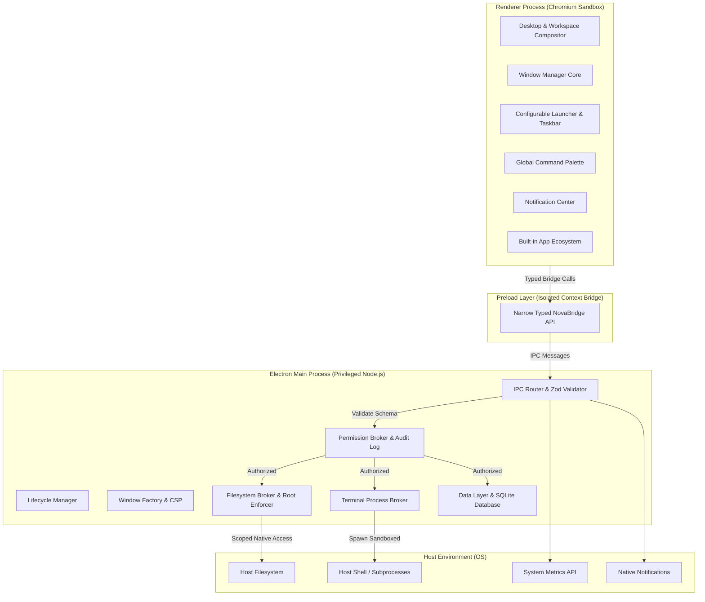

# NovaOS Architecture Specification

**Document ID:** NOVA-ARCH-001  
**Version:** 0.1.0  
**Status:** Approved  

---

## 1. System Topology & Trust Boundaries

NovaOS strictly isolates the untrusted Chromium renderer from Node.js capabilities using defense-in-depth Electron boundaries:

---

## 2. Layer Definitions

### 2.1 Electron Main Process
The Main Process executes in a trusted Node.js runtime and is responsible for:
- **Application Lifecycle**: Managing single instance lock, window creation, clean shutdown, and background task management.
- **Window Hardening**: Initializing `BrowserWindow` with `contextIsolation: true`, `nodeIntegration: false`, `sandbox: true`, `webSecurity: true`, and registering strict Content Security Policies (`default-src 'self'`).
- **Secure IPC Router**: Exclusively handling registered IPC channels. Every request passes through a Zod runtime validator. Requests with invalid schemas are immediately rejected and logged.
- **Permission Broker**: Evaluates requested capabilities (`host-filesystem:read`, `host-filesystem:write`, `terminal:execute`, `system:info`, `clipboard:read`). If a permission is not granted, a modal confirmation dialog is shown to the user. Grants are logged to an audit table in SQLite.
- **Filesystem Broker**: Enforces path confinement. Resolves canonical realpaths to guarantee that operations cannot escape approved directories (e.g. preventing `../../Windows` traversal). Distinguishes virtual Nova Home storage from permitted host folders.
- **Terminal Broker**: Safely spawns approved shells (`powershell.exe`, `bash`, `zsh`) with structured parameter arrays. Never passes raw concatenated command strings to `cmd.exe` or `sh -c`. Confines child processes to approved working directories.
- **Data Layer**: Embeds Node's native `node:sqlite` database for state persistence (window geometry, user preferences, permission grants, virtual filesystem tree, notes, notifications).

### 2.2 Preload Layer
The Preload script acts as an impenetrable gateway:
- Executes within an isolated context.
- Exposes a typed object `window.nova` containing only specific capability methods (`nova.system.getInfo()`, `nova.fs.list()`, `nova.terminal.sendInput()`, etc.).
- Does **not** expose `ipcRenderer`, `process`, `require`, `Buffer`, or generic `invoke` channels.
- Formats payloads and checks return structures before handing them to the renderer.

### 2.3 Renderer Process (Nova Surface Shell)
The Renderer is written in React + TypeScript and runs under Chromium sandbox restrictions:
- **Compositor**: Manages the desktop wallpaper, responsive desktop grid, selection rectangle, and context menus.
- **Window Manager**: Handles window lifecycle (open, focus, minimize, maximize, snap, resize, close). Maintains an active Z-index stack, coordinates snap geometry (split screen, quarter quadrants), and enforces accessibility focus traps.
- **Workspaces Engine**: Supports virtual workspaces (Desktops 1..N) with isolated window visibility, animated transitions, and overview switching.
- **Global Command Palette**: Instant modal invoked via `Cmd+Space` or `Ctrl+Space` allowing search across installed applications, recent files, system actions, and preferences.
- **Shell UI**: Universal launcher configurable into three modes:
  - *Floating Dock* (macOS style ergonomics)
  - *Classic Taskbar* (Windows style productivity and window grouping)
  - *Compact Top/Bottom Panel* (Linux/GNOME/KDE style status efficiency)
- **Built-in App Ecosystem**: Fully isolated application views communicating solely through the Nova Surface component contracts.

---

## 3. Data Flow & Transaction Lifecycle

When a built-in app requests a file read:
1. App calls `window.nova.fs.readFile({ path: 'nova://documents/report.txt' })`.
2. Preload bridge wraps the call and sends IPC event `nova:fs:read` to the Main Process.
3. IPC Router validates the message schema with `Zod` (`z.object({ path: z.string() })`).
4. Permission Broker checks whether the requested path resides in *Nova Home* (implicit grant) or an *External Host Path* (requires `host-filesystem:read` capability).
5. If external, the broker checks whether the path is within the user's previously permitted folder grant. If not, it requests explicit user approval.
6. The Filesystem Broker canonicalizes the path, verifies that no directory traversal (`../`) escapes the root, reads the file safely, and returns the contents.
7. The IPC Router serializes the sanitized response back to the Preload bridge.
8. The App receives the data and renders the view.
