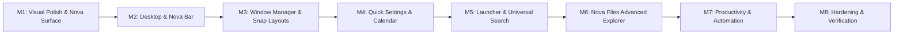

# NovaOS — Implementation Backlog: Windows-11-Level Polish

**Document ID:** NOVA-BACKLOG-001  
**Project:** NovaOS — One Desktop. Three Worlds. One Experience.  
**Version:** 0.2.0-alpha  
**Date:** November 14, 2026

---

## Milestone Overview & Epic Tracking

---

## Epic 1: Nova Surface Visual Language & Design Tokens
- [x] Base dark, light, and high-contrast CSS variable tokens in `src/renderer/styles/tokens.css`.
- [ ] **Windows-11-grade translucency & acrylic/mica materials**: subtle backdrop-filter blurs, layered elevation cards, low-noise soft box-shadows.
- [ ] **Smooth micro-animations**: spring transitions for window open/close, dock bounce/scale, command palette fade-in, snap preview easing.
- [ ] **Typography scale & density**: crisp typography, support for "Comfortable" vs "Compact" density modes.
- [ ] **Wallpaper gallery**: support for 5 high-resolution built-in abstract desktop backgrounds + custom user wallpaper loading.

---

## Epic 2: Desktop Canvas & Nova Bar Polish
- [ ] **Interactive Desktop Canvas**:
  - [ ] Multi-select marquee (rubberband selection box) on desktop background.
  - [ ] Grid snapping for desktop file icons with persistent saved positions.
  - [ ] Right-click desktop context menu: "New Folder", "New Note", "Change Wallpaper", "Display Settings", "Arrange Icons".
  - [ ] Drag-and-drop rearrangement of desktop icons.
- [ ] **Nova Bar (Centered / Left Taskbar)**:
  - [ ] Centered vs Left alignment toggle with smooth transition animation.
  - [ ] App running indicator pill (active, minimized, background).
  - [ ] Running-window grouping popup (hover preview card with thumbnail/title and close button).
  - [ ] Notification badges with real unread counts.
  - [ ] Drag-to-reorder pinned apps.
  - [ ] Active workspace indicator pill with quick switch popover.
- [ ] **System Status Area**:
  - [ ] System clock with date + click-to-open Calendar popover with month view and upcoming events.
  - [ ] Network status icon with simulated/actual WiFi signal strength indicator.
  - [ ] Volume slider popover with audio mute toggle.
  - [ ] Battery level & charging status indicator.
  - [ ] Privacy indicators (camera, microphone, location) when active.

---

## Epic 3: Advanced Window Manager & Windows-11-Grade Snap Layouts
- [ ] **Interactive Snap Menu on Maximize Button Hover**:
  - [ ] Hovering over the window maximize button pops up a snap layout picker (Halves: 50/50, Thirds: 33/67 or 33/33/33, Quarters: 2x2 grid, Side-by-side with sidebar: 25/75).
  - [ ] Clicking a snap zone immediately snaps the active window to that portion of the screen.
- [ ] **Snap Assist / Snap Suggestions**:
  - [ ] After snapping a window to the left/right/quadrant, automatically show a thumbnail picker of other running windows to snap into the remaining empty space.
- [ ] **Edge & Corner Drag-to-Snap**:
  - [ ] Dragging window to top snaps to full screen.
  - [ ] Dragging window to left/right edge snaps to half screen with animated translucent highlight preview.
  - [ ] Dragging window to any of the 4 screen corners snaps to quarter screen.
- [ ] **Saved Project Layouts & Layout Templates**:
  - [ ] "Save Current Layout as Preset" (e.g. "Coding Layout", "Research Layout", "Writing Layout").
  - [ ] One-click layout restoration.
  - [ ] "Focus This Group" — temporarily minimizes all windows not in the active group.

---

## Epic 4: Quick Settings & Notification Center
- [ ] **Windows-11-Inspired Quick Settings Flyout**:
  - [ ] Unified quick toggles for: Theme (Dark/Light/High-Contrast), Accent Color picker, Focus Session (Do Not Disturb), Density mode, Transparency effects on/off, Reduced motion on/off.
  - [ ] Volume slider with mute button.
  - [ ] Display profile brightness simulation slider.
  - [ ] Honest indicators: clearly badges host capabilities vs simulated preferences.
- [ ] **Grouped Notification Center**:
  - [ ] Time-ordered grouping: "Today", "Earlier", "System".
  - [ ] Per-app notification headers with app icon and "Clear All".
  - [ ] Interactive action buttons on notifications (e.g. "Open Note", "View File", "Dismiss").
  - [ ] Focus mode (Do Not Disturb) banner with timer option (e.g. 25m Pomodoro, 1 hour).

---

## Epic 5: Universal Nova Launcher & Search
- [ ] **Hybrid Start / Universal Search Experience**:
  - [ ] Triggered by Start button on Nova Bar or `Super` / `Win` key or `Ctrl+Space`.
  - [ ] Instant search filtering apps, files, settings, and commands.
  - [ ] "Continue Working" section showing recent files and notes.
  - [ ] "Pinned Apps" section with customizable grid.
  - [ ] "Quick Actions" (New Note, Open Terminal, Launch Calculator, Take Screenshot).
  - [ ] Full keyboard navigation (Arrow Up/Down, Enter to launch, Escape to close).
  - [ ] Local-only privacy guarantee: search queries never leave local machine.

---

## Epic 6: File Explorer — Nova Files
- [ ] **Tabbed File Browsing**:
  - [ ] Multiple tabs with `+` new tab and `x` close tab.
  - [ ] Breadcrumb navigation with clickable folder segments.
  - [ ] History navigation (Back `<` and Forward `>`).
- [ ] **Multiple View Modes**:
  - [ ] Large Icons Grid, Details Table (Name, Size, Type, Modified Date), List, Gallery.
- [ ] **File Operations & Inspector**:
  - [ ] Multi-file selection, rename in-place, delete to Trash, restore from Trash.
  - [ ] File tags and favorites (stars).
  - [ ] Collapsible Preview Pane for markdown, text, images, and audio files.
  - [ ] Storage breakdown indicator (Nova Home space vs host folder links).

---

## Epic 7: Modern Productivity Features & Automation
- [ ] **Named Workspaces for Projects**:
  - [ ] Workspaces can be named (e.g. "Project Nova", "Design", "Research", "Dev").
  - [ ] Reorderable workspaces, custom icons, and per-workspace wallpaper.
- [ ] **Focus Sessions (Pomodoro & Distraction Reduction)**:
  - [ ] Built-in focus timer in Clock app with integration into Quick Settings.
  - [ ] Automatic notification silencing during focus session.
- [ ] **Clipboard History**:
  - [ ] In-app clipboard manager (`Win+V` or via Launcher) storing recent copied text snippets inside NovaOS.
- [ ] **Work Presets**:
  - [ ] "Resume Coding" (opens Terminal + Dev Console + Files in split layout).
  - [ ] "Focus Writing" (opens Notes maximized in distraction-free mode).
  - [ ] "Research Mode" (opens Files + Notes + Media Viewer side-by-side).

---

## Epic 8: Verification, Test Suites & Release
- [ ] Add unit & component tests for new interactive features:
  - [ ] Snap layout hover menu & snap assist.
  - [ ] Desktop canvas icon drag/drop and context menu.
  - [ ] Quick settings toggles and flyouts.
  - [ ] Calendar popover date calculations.
  - [ ] File explorer tabs and multi-select.
- [ ] Ensure 100% test pass rate across all suites.
- [ ] Zero TypeScript errors in both renderer and node configs.
- [ ] Rebuild and package Windows binary in `release\win-unpacked\NovaOS.exe`.
