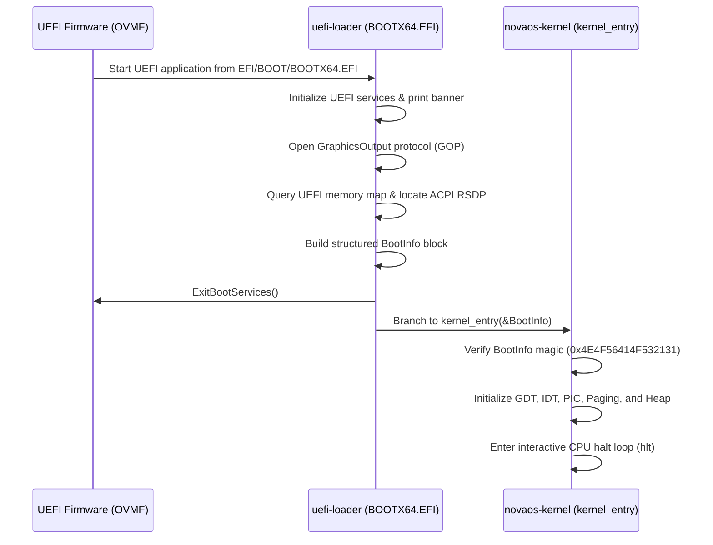

# NovaOS Boot Process Specification

1. **UEFI Entry:** The firmware locates `\EFI\BOOT\BOOTX64.EFI` on the FAT32 boot volume.
2. **Protocol Discovery:** `uefi-loader` requests the Graphics Output Protocol (GOP) to obtain the physical address, dimensions, and pixel format of the display framebuffer.
3. **Memory Map Construction:** `boot_services.memory_map()` records physical RAM regions.
4. **BootInfo Handover:** `BootInfo` structure is populated with framebuffer details, memory regions, and ACPI pointers.
5. **Exit Boot Services:** Firmware boot services are terminated. Control transfers to `kernel_entry`.
